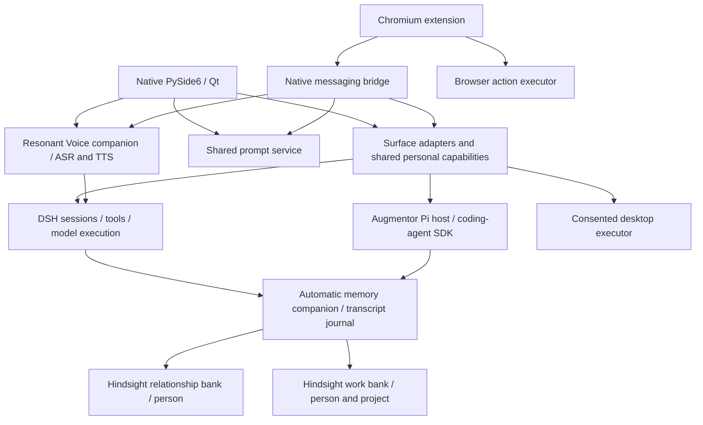

<!-- Copyright © 2026 Manolo Remiddi · SPDX-License-Identifier: LicenseRef-Augmentor-MIT-Resale-1.0 -->

[Original literal prompt wrapping on Pi](CONTEXT-PROMPT-WRAPPING.md) connects the copied Prefix/Suffix card to the supplier's verbatim section registration and Pi's request-time context hook. Each conversational request records its own private preference revision; native originals, tool state and the single owner are preserved. Source, ordinary and installed qualification are distinct. The Fleet release below remains selected/running until guarded promotion; complete migration/live/public packaging/platform gates remain open.

[Installed original Fleet on Pi](CONTEXT-FLEET.md#installed-mx-qualification--october-12): corrected runtime a449d28b90e0d20877daae51a7075b765ce3ad12, private MX 20261012-052408-d60add65, product 0.2.13, artifact 3638106b09b6fcd4d15b39fedbd807e7a88e14c92a5eab20cf9ecf92920c4200, selected and running. Source and ordinary Node 24.19.0 each pass 283/283 across 52 files; two ordinary packaging cases pass. The copied graph/inspector/roster/comms widgets, ninth display preference and scoped read-only child links use exact-parent retained Pi records. All 22,657 installed inventory entries and eleven preserved histories/queues pass. Fleet Hide and the viewport are restored; Insights stays open. MIT DSH selection is 483 files; Apache-2.0 dsh-context is 107 (91 verbatim/16 marked). Coordinated Teams/mailbox, prompt wrapping and complete migration/live/public packaging/platform gates remain open. Preceding selected/running statements below describe their historical checkpoints.

[Qualified recorded family identities for the original Fleet view](CONTEXT-FLEET.md#qualified-source-and-ordinary-checkpoint--october-12): unselected source 1936fd7756b3beefb5dc2d72e923561e3ae6e48d, source and fresh ordinary Node 24.19.0 each pass 280/280 across 50 files; two ordinary packaging cases pass. The read-only exact-parent catalogue proves saved job/child identities and explicit pending/unavailable/unknown evidence without inference or usage attribution. All 133 dependency instances, Node/native bytes and 731 licence files match the installed sidebar release. Selected/running MX remains 6518808 / 20261012-031413-3c3b8dc9. Original Fleet registration, detail/cache bindings, GUI/installed/live acceptance and full migration gates remain open.

[Installed original Context sidebar and placement](CONTEXT-SIDEBAR.md#installed-mx-qualification--october-12): corrected runtime 65188080085323335a7c290dd5d43f5c851c0a0c, private MX 20261012-031413-3c3b8dc9, product 0.2.13, artifact 64ab34e468f045ab5e6d580366507750d8753a0c93c77b043e8c82e41576e139, selected/running. Source and ordinary Node 24.19.0 each pass 278/278 across 48 files; two ordinary packaging cases pass. Original Tab/Sidebar/All, guide capsule, independent scrolls and File Activity previews use Pi retained-data/IO with the original slow-read loading indicator. Actual installed narrow/wide/reload/file acceptance and 22,645 inventory entries pass. Eleven histories/queues, original prefixes, drafts/attachments and settings values are preserved; the temporary placement and viewport are restored. MIT DSH selection is 483 files; Apache-2.0 dsh-context is 100 (87 verbatim/13 marked). Pinned MIT picomatch 4.0.7 has reviewed notices. Complete migration/Fleet/prompt/live/privacy/public packaging/platform gates remain open; preceding qualifications below are historical checkpoints.

[Installed original Harness file previews](HARNESS-FILE-PREVIEWS.md#installed-mx-qualification--october-12): corrected runtime dacba8c341e56a3265b51d36bf6a2620c3e87de7, private MX 20261012-015903-110d1bc4, product 0.2.13, artifact 24f77f8e70136a4e32d74af7e1b47a1eb1ab044d4ab65f8bc6419ab4a0a99a5a, selected/running. Source and ordinary Node 24.19.0 each pass 277/277 across 47 files; two packaging cases pass in each tree. Original chip/sidebar/context/Insights, actual file reload, cold tab/draft restoration, maintenance veto and clearing pass with 22,630 verified inventory entries. Eleven histories/queues, old original prefixes, attachment bytes and settings remain preserved. MIT supplier selection is 482 files; Apache-2.0 dsh-context remains unchanged. Pinned MIT Zod 4.4.3 and original ISC YAML frontmatter have reviewed notices. Full viewers/shortcuts/migration/privacy/public packaging/platform gates remain open.

[Installed original Harness file references](HARNESS-FILE-REFERENCES.md#installed-mx-qualification--october-12): runtime debe8040c7a02ea958c9d5aabbf07cacff757a89, private MX 20261012-002708-3571d021, product 0.2.13, artifact 1b08c0220f3e5760e905f60430bca530645878aaaeb7412d7e1c149813da853a, selected/running. Source and ordinary Node 24.19.0 each pass 272/272 across 45 files; guarded adoption, exact roots and all 21,821 inventory entries pass. Original @file completion/chips restore exact rich drafts; installed reload/veto/clear and retained Insights reads pass without owner inference. Eleven histories/queues, prior original prefixes, attachment bytes, profile/model/speech settings remain preserved; only owned fixture draft metadata changes. Session references, click previews, full migration/privacy/public packaging/platform gates stay open.

[Preceding installed original Harness drafts](HARNESS-DRAFTS.md#installed-mx-qualification--october-11): runtime 6f6bf39071839d1e023a648247bb9ff89892b5ce, private MX 20261011-235335-2d8c7e8f, product 0.2.13, artifact 5cfd01bb69668bc52a2a5801cd1b9c7540f1fb1c6c28c9604007c38d0809f8d2, selected/running. Source and ordinary Node 24.19.0 each pass 266/266 across 43 files; guarded adoption, exact roots and all 21,792 inventory entries pass. The original composer restores unsent text/real bytes/exact receipts; dirty drafts and receiving operator requests veto shutdown. Installed reload/veto/clear and original Context/Insights reads pass. Eleven histories/queues and preceding private files/settings are preserved with classified lifecycle/title/index appends and one owned fixture receipt. Supplier/CSS/licences/dependencies/model/speech settings remain preserved; full migration/privacy/public packaging/platform gates stay open.

[Preceding installed upload maintenance safety](UPLOAD-MAINTENANCE.md#installed-mx-qualification--october-11): runtime 71c8295331e3ef6f1a3fadecdee2b3e16dde75cf, private MX 20261011-230903-26a85087, product 0.2.13, artifact a4e02988958781788a17c4e78018cbc7219c6e510e4ed41f0793584d24c3c70c, selected/running. Source and ordinary bundled Node 24.19.0 each pass 256/256 across 40 files; guarded sequential adoption, exact running roots and all 21,787 inventory entries pass. Original GUI/licences/dependencies/profile settings, eleven histories/queues and old original prefixes are preserved with classified lifecycle/title/index appends. Insights stays open for feedback. Full draft/migration/privacy/public packaging/platform gates remain open.

[Attachment upload maintenance safety](UPLOAD-MAINTENANCE.md) counts the full HTTP reception and immutable storage phase, so slow and concurrent transfers veto guarded shutdown. Source checks/build and 256/256 across 40 files pass; ordinary/installed qualification is recorded separately. Original DSH GUI, supplier licences and dependencies are unchanged; durable drafts and full migration/platform gates remain open.

[Installed original Context preferences](CONTEXT-PREFERENCES.md#installed-mx-qualification--october-11): runtime 52a0368f1f3272c8c202879ffca894eca22bbe06, private MX 20261011-224436-af6876b9, product 0.2.13, artifact d15089e3b6545205c7c55a7ec98b4d69adb035ba089e0d0e7ce7ab4a47ab7175, selected/running. Source and ordinary Node 24.19.0 each pass 251/251 across 38 files. Guarded adoption, matching Host/Native roots and the full 21,786-entry inventory pass. The original card persists seven display defaults; installed Turn/reload/chart acceptance restores Step. Eleven histories/queues and old original prefixes are preserved with classified title/lifecycle/index changes and exactly two display-only settings writes. Dependencies/native/supplier licence bodies/CSS/model/speech settings remain preserved; full Harness/migration/live/privacy/public packaging/platform gates stay open.

[Original Context preferences](CONTEXT-PREFERENCES.md) connects the supplier settings card to seven private, revisioned Pi display defaults. Unsupported Fleet/sidebar/prompt-wrapping controls remain visibly disabled; stale/unknown writes require explicit refresh and are never replayed. Source/ordinary/installed qualification follows in the guide; complete Harness and platform gates remain open.

The [original Context Insights adapter](DSH-GUI-ON-PI.md#installed-original-context-insights--october-11) is a browser presentation reader over existing Pi catalogs/observations. Bounded metadata/newest-body reads create no additional agent owner or inference loop. The original supplier overview, Context tab and slash modal share the same retained-data boundary; incomplete plugin/platform parity remains explicit.

[Installed original Context dialog](DSH-GUI-ON-PI.md#installed-original-context-dialog--october-11): runtime 3a112af4633d6259c1866650044a423459d45997, private MX 20261011-212056-aeaf1a5c, product 0.2.13, artifact e933bb08a2128614d8136dc35ced23a5f482609f955eb6487f2a6910bb0c19d7, selected/running. Source and ordinary Node 24.19.0 each pass 232/232 across 34 files; guarded update and 21,767 installed inventory entries pass. Original `/context` preserves Chat, recorded arguments and scoped deferred text consumption. All eleven histories/queue identities and prior original prefixes are preserved with six classified title/lifecycle appends and their index/counter updates. Supplier licences/CSS/dependencies/native/model/speech settings remain preserved; full migration/live/privacy/public packaging/platform gates stay open.

[Original Context slash dialog](DSH-GUI-ON-PI.md#original-context-slash-dialog--october-11-follow-up) is a local presentation over the same retained Pi projections. Deferred slash consumption is fenced to an unchanged composer span/revision and session/connection epoch; no agent/action authority is added.

[Installed recorded-format qualification](DSH-GUI-ON-PI.md#installed-recorded-format-qualification--october-11) maps Anthropic, Responses and Gemini snapshots into the unchanged original Context dashboard, with exact request-local IDs, ordered fragments and explicit unavailable/opaque data. Runtime f5ff7be4d346213ef0b8dc463072261196b8c440 is selected/running in private MX release 20261011-205518-9903c1a4, product 0.2.13, artifact c6727cc06f6119aa6dc633df97b1371e191559616c33d3a3a1604b483ecd2803. Source and ordinary bundled Node 24.19.0 each pass 227/227 across 32 files; guarded immutable adoption and 21,763 inventory entries pass after GUI reads. Eleven displayed histories/queue identities and all prior original bytes are preserved, with six explicitly classified lifecycle/title appends and their counter/index updates. Synthetic new-API execution and retained installed Qwen inspection remain separate; no new owner inference/tool action occurs. Supplier/CSS/licence/dependency and model/speech settings are unchanged. Complete migration/live-provider/privacy/public packaging/platform gates stay open.

[Earlier-request qualification](DSH-GUI-ON-PI.md#installed-earlier-request-qualification--october-11) connects the original dropdown to explicit metadata paging and a bounded older-body read without fake chart bars or borrowed contents. Runtime dd478b51c7bf4f145051185b4cc3f00d11f1d258 is selected/running in private MX release 20261011-203308-c2b28497, product 0.2.13, artifact e25b512f420703de41951e7fcb60d1c4700f84f49b6c8379aaee7d1a78cbafa1. Source and ordinary bundled Node 24.19.0 each pass 217/217 across 30 files; guarded immutable adoption and 21,761 inventory entries pass after GUI reads. All eleven histories and queue identities are preserved with no new admissions/provider requests/tools. Synthetic saved-data paging and installed retained Qwen-record inspection are separate evidence. Apache-2.0 originals/CSS/licences remain preserved with five marked adaptations; DSH MIT sources/dependencies and model/speech configuration are unchanged. Full migration/privacy/public packaging/platform gates remain open.

[Context argument qualification](DSH-GUI-ON-PI.md#installed-context-argument-qualification--october-11) restores exact provider-call arguments in the original dashboard. Source/ordinary 210/210 and private MX selection 1bc4560 / 20261011-195826-1738f137 are qualified separately from full migration/platform acceptance; all eleven histories are preserved. Synthetic fresh-Host execution and installed retained Qwen-record reads start no replay. Supplier/CSS/licences/dependencies and the single Pi owner are unchanged; all remaining context/migration/public packaging gates stay open.

[Original DSH Settings](DSH-GUI-ON-PI.md#final-installed-settings-qualification--october-11) is a copied MIT presentation shell over existing scoped Pi handlers. It adds no execution owner. MX source/ordinary/installed evidence is qualified separately; original dashboard data gaps and all remaining migration/platform gates are retained.

October 11 Windows command follow-up: [owned Pi shell jobs](WINDOWS-SHELL-JOBS.md) replace direct-process-only Stop with a contained kernel Job, readiness before command release, private parent lease and truthful no-replay settlement. Eight real helper cases pass on both x64 and ARM64; actual Windows Host/assembled/physical acceptance remains open. Unix keeps the existing process-group adapter. Shared Native/Browser layout, installed selections and the full migration gates are preserved.

October 11 specialist follow-up: [desktop jobs](PI-JOBS.md#desktop-specialist-jobs) now use the shared durable registry, distinct native SDK histories, pre-dispatch intent, scoped approvals/Stop, unknown recovery and one-time usage. Harness exposes child originals and optional provider payloads through parent-owned read-only inspection. Synthetic source/staged qualification does not establish live perception, physical consent or installed platform acceptance. Every remaining accepted P0/P1 gate and DSH retention remains binding.

October 11 jobs follow-up: [background jobs and delegation](PI-JOBS.md) add exact-parent durable receipts, real bounded SDK children and commands, root/nested tool grants, scoped approvals/Stop, unknown restart recovery and saved one-time usage attribution. This advances the combined P1 requirement; actual concurrent integration, live services and every accepted P0/P1/platform/installed gate remain required.

[Persistent Pi goals](PI-GOALS.md) retain branch-owned completion state through a selected public MIT DSH fold. Explicit human continuation uses the existing public Pi owner and durable Host queue. Restart/fork/reload disarm it; Stop pauses active state. Plans, jobs and verified outcomes remain separate.

The [Pi planning candidate](PI-PLANNING.md) stores revisioned plans and explicit todo states in native branch custom entries through the public SDK. Its Plan view reads the existing owner or verified cold originals. Reported progress grants no task-completion evidence, execution authority or autonomous goal/job loop.

The October 10 Native/Browser follow-up adds effort/mapping controls in existing settings locations. Browser and Harness use one DOM form; Native uses a Qt client of the same serialized Pi owner. Forms do no inference or automatic model selection. Browser operations check the selected conversation and standalone authority; global administration stays out of SDK workspaces. Context/model/working changes invalidate dialogs and late results, and open settings participate in maintenance admission. See [Native and Browser reasoning qualification](AUGMENTOR-HARNESS.md#native-and-browser-reasoning-controls).

The October 10 Adaptive Reasoning candidate composes the existing AgentSession's public `prepareRequest`, `transformContext` and tool guard after session ownership and routing. The selected MIT pure policy classifies host-correlated delivered SDK input; explicit profile mappings choose supported effort for the actual routed model. An unmapped model preserves its request level. Request-only editing guidance/schema filtering is applied after the SDK's prompt projection and never mutates canonical history or global tools. Manual effort and mode are per conversation; mappings are profile settings. [Adaptive Reasoning qualification](AUGMENTOR-HARNESS.md#adaptive-reasoning-and-effective-thinking-controls) owns the supported boundaries and remaining Native/Browser/live routing gates.

The [shared prompt Harness checkpoint](AUGMENTOR-HARNESS.md#shared-prompt-library-and-editor) reuses the public Browser picker/editor as a client of the Pi Host and existing shared prompt service. There is no separate database or agent loop. Saved prompts, their revisions and improvement instructions keep their existing service owner; Pi draft improvement and full composition/provenance remain migration gates. This is source/staged qualification, not installed activation.

The [Augmentor Harness candidate](AUGMENTOR-HARNESS.md) adds an authenticated local inspection client of the existing Pi owner. It does not add an agent loop. The [migration specification](AUGMENTOR-HARNESS-MIGRATION.md) defines the features and cutover gates still required.

# Current architecture

See [embedded Browser and specialist workspaces](WORKSPACE-EMBEDDING.md) for product-owned embedding, scoped tools and memory.

The [SDK alignment candidate](SDK-ALIGNMENT.md) defines capability negotiation,
experimental Codex application workers and product-owned platform launch adapters.
Application selection is untrusted evidence; Codex persists it with its operation
identity, while DSH retains the existing session-selection contract. Application
records, authorization and receipts remain owned by the application's backend.
Embedded appearance/thinking preferences use the authenticated profile store
and profile-specific browser caches; shared desktop settings remain standalone.

Product version is defined by [the shared manifest](../release/product.json). Start with the
[agent handoff](AGENT-HANDOFF.md) for the authoritative Git ref and evidence.
The [documentation index](README.md) maps every subsystem to its detailed guide.
The [original 0.1 design](HISTORICAL-ARCHITECTURE-0.1.md) is historical.

Installed Linux desktop selection follows [desktop deployments](DESKTOP-DEPLOYMENTS.md):
one atomic descriptor selects a separately staged release for login, launchers,
recovery and mobile. Working source trees are not the installed release.

## One product across operating systems

Linux and macOS must use the same product features, desktop UI and behavioral
contracts. OS-specific adapters provide shortcuts, window integration, permissions,
service ownership and packaging. A feature or fix on either OS requires an impact
assessment and applicable implementation/tests on the other. A missing adapter
remains a parity gap; it does not authorize a reduced feature specification.

Read the [September 26 architecture audit and correction sequence](PLATFORM-PARITY-AUDIT.md)
for the verified two-instance shortcut gap, divergent installed artifacts, test
coverage gaps and shared-interface boundaries. This direction extends the existing
architecture; the audit itself does not implement the pending changes or update
installed apps. The owner's approved UI remains the design baseline.

## Product and runtime ownership

The [Codex integration build plan](CODEX-INTEGRATION-PLAN.md) defines the third
harness for both surfaces. Its [development implementation](CODEX-INTEGRATION.md)
uses the pinned native app-server as the agent engine and the same presentation,
memory and tool companions. API/local setup and internal
[OAuth/account lifecycle primitives](CODEX-ACCOUNTS.md) are implemented; subscription login wiring
and full acceptance remain open. [Shared memory source activation](CODEX-INTEGRATION.md#codex-memory-launcher-and-existing-interface-controls)
is qualified through isolated Qt/Chromium interfaces. This development source
has not replaced the installed DSH/Pi applications or completed release gates.

Augmentor is one product with native PySide6/Qt and Chromium surfaces in this
repository. Both DSH presentations use [one personal-agent composition and voice engine](SHARED-SURFACES-2026-09-24.md); preset IDs are historical aliases. DSH is the full-featured conversational harness; Pi is a supported
subset. Each chat stays owned by its selected harness. Neither memory nor voice
starts another conversational agent. OpenCode is retired; its old data remains.

The diagram shows logical ownership, not every transport call. Voice uses the
existing authenticated DSH session and generation protocol. Desktop authority
is not granted to a browser session by sharing a host or memory bank.

The [Home development preview](HOME.md) adds a headless host of the same DSH
session/tool lifecycle. Home Assistant owns device integrations through official
Assist MCP; Home grants neither desktop tools nor personal memory. Its application
code is in this repository and its deployment companion holds private home state.

## Source map

| Owner | Source | Contract and detail |
| --- | --- | --- |
| Native surface | `apps/native/augmentor_linux` | [Native map](../apps/native/README.md); controllers choose Pi or DSH |
| Chromium surface | `apps/browser/extension`, `native-host.mjs`, `pi-bridge.mjs`, `pipe.mjs` | [Browser](../apps/browser/README.md), [distribution](BROWSER-DISTRIBUTION.md) |
| Pi lifecycle | `packages/runtime`, `packages/pi-linux` | [Pi protocol](PROTOCOL.md), tested Harness SDK 1.1.0; installed builds retain their recorded contracts |
| DSH setup, sessions, exact branching | `services/dsh`, `adapters/dsh-product`, `adapters/dsh-steering` | [DSH setup](DSH-SETUP.md), [feature boundaries](FEATURE-MATRIX.md) |
| Shared prompts and templates | `services/prompt-library`, `packages/prompt-library`, `packages/templates`, `adapters/dsh-prompt-library` | [Prompt improvement](PROMPT-IMPROVEMENT.md), [commands](SLASH-COMMANDS.md) |
| Shared visual behavior | `packages/design`, `scripts/sync-design.py` | [Skins](SKINS.md); build generates surface bindings |
| Automatic memory | `services/memory/{service,hindsight,dual}.py`, `packages/memory/src/dual.ts`, `adapters/dsh-memory/automatic.mjs` | [Architecture](DUAL-MEMORY.md), [operations and RPC](MEMORY-OPERATIONS.md) |
| Optional manual memory | `services/memory/provider.py`, prompt-service routing, `packages/memory/src/index.ts` | [Manual memory](MEMORY.md); separate 0.9.2 connection |
| Speech engine and plugin | Separate [Resonant Voice repository](https://github.com/ManoloRemiddi/resonant-voice) | [Voice handoff](https://github.com/ManoloRemiddi/resonant-voice/blob/main/docs/AGENT-HANDOFF.md); protocol `resonant-voice/1` |
| Audio controls and capture | Shared native `VoiceSession`; browser `voice.mjs` via private stdio worker | [Controls](VOICE-SINGLE-BUTTON.md), [hands-free](HANDS-FREE-IMPLEMENTATION.md) |
| Desktop tools / specialist | `services/desktop`, `packages/desktop`, `packages/computer-use`, `adapters/dsh-desktop` | [Desktop control](DESKTOP-CONTROL.md), [specialist](DESKTOP-SPECIALIST.md) |
| Recovery, maintenance and support | `services/recovery`, `services/lifecycle`, `services/support`, `scripts/maintenance.py` | [Recovery](DESKTOP-OFFLINE-RECOVERY.md), [lifecycle](LIFECYCLE.md), [data](DATA-AND-SUPPORT.md) |
| Packaging and compatibility | `release`, `scripts/package-*`, `.github/workflows/validate.yml` | [Sources](SOURCES.md), [release status](CROSS-PLATFORM-RELEASE-STATUS.md) |

## Memory decision

The user requested two independent kinds of continuity: relationship knowledge
and project state. Reuse MIT-licensed Hindsight 0.10.0 for extraction,
consolidation, knowledge pages and hybrid retrieval. Relationship banks maintain
wiki-like pages; project banks support semantic retrieval plus a current-state
page. This is one maintained memory engine with separate banks, not one mixed
summary. A vector database alone would not maintain a distilled relationship;
handwritten summaries would duplicate existing memory-engine work.

Augmentor owns capture, stable person/project bindings, a durable SQLite source
journal, durable processing stages/budgets, selected cached context, and separate
capture/processing pause controls. Its memory-only gateway admits inference only
during bounded activity windows; no idle archive drain is permitted. See
[controlled memory](CONTROLLED-MEMORY.md).
Hindsight owns PostgreSQL/pgvector, derived facts, observations and pages. The
custom automatic summarizer is retired. Voice signals a relational register;
it does not establish speaker identity. Both typed and spoken turns can
contribute to both banks. See [dual memory](DUAL-MEMORY.md) for boundaries.

## State and recovery contracts

Pi persists its own conversation state; DSH persists its own. Shared memory does
not merge or convert conversations. Prompt records are independently stored in
`prompts.sqlite3`; automatic transcript memory uses `dual-memory.sqlite3`.
Speech configuration belongs to Resonant Voice. UI preferences belong to the
surface. [Data and support](DATA-AND-SUPPORT.md) explains data flow and retention.

Preserve selected models, explicit surface authority, Stop, pending interactions,
and original history. A reconnect or unknown acknowledgment must not replay a
model/tool action. Historical branching must preserve the selected boundary and
must not inject newer automatic memory into the historical context. Memories,
web pages and transcripts are evidence, never execution authority.

## Deployment boundaries

Source, CI artifacts, installed packages and the user-local preview are distinct.
The September memory upgrade stages a versioned user-local adapter and requires
idle DSH/voice before activation; it does not replace the root-owned desktop or
installed browser extension. Native controls refresh on a natural restart.
Speech is a separate versioned tarball, not a sibling runtime import.
See [handoff](AGENT-HANDOFF.md) for exact qualification and remaining work.

The September 20 user-local desktop deployment has one registered build and a
graphical-session supervisor. DSH startup ownership is shared by its surfaces;
permanent saved-chat failures are distinguished from transport loss. See
[restart reliability](RESTART-RELIABILITY-2026-09-20.md) for installation scope,
legacy diagnostic repair and cold-start evidence.
