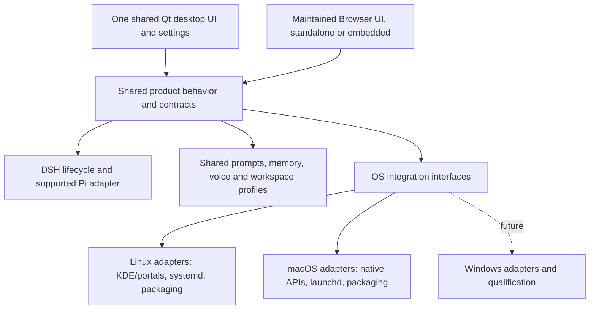

<!-- Copyright © 2026 Manolo Remiddi · SPDX-License-Identifier: LicenseRef-Augmentor-MIT-Resale-1.0 -->

[Historical DSH reply branches](HARNESS-DSH-MIGRATION-PILOT.md#historical-reply-branches--october-16) now run in both existing MX reviews. Private unselected **20261016-204440-a6f079ca**, application **deea778d** / test qualification **34f43a99**, passes **303/303 source and exact packaged cases** across 65 files / 20 Chromium files, plus sixteen licence/private-boundary/notice checks each. Source-cut reconstruction retains then-current compactions/offloads/images and fixes native reply/Edit ordinals after import. Guarded idle-only adoption verifies **408 backup files / 32 cold and post-GUI protected inputs**, four conversations, 12 prompts, 19 captured records and 17 pending memory entries. Actual pilot read-only inspection exposes two archived children and source excerpts without new work. Configured 10 groups/431 models/10 pins and engine/settings/selected installation remain unchanged. [Portable evidence](../release/harness-dsh-branch-review-20261016.json). No further real projects, owner branch/model work, voice or later-OS rollout; pilot feedback remains required before bulk migration.

[Archived DSH child inspection — preceding checkpoint](CONTEXT-FLEET.md#archived-dsh-child-inspection--october-16) adds verified read-only families to the original Fleet and conversation shell. Source and exact packaged tests pass **294/294** across 62 files / 18 Chromium files, plus sixteen licence/private-boundary/notice Python checks each. Private unselected MX **20261016-202020-adced449**, application **4434b031**, verifies **24,607 sealed / 1,099 compiled** inputs. Nested children, source excerpts and child-only images retain parent/cut/archive scope without Pi jobs, replay or inferred provider usage. At that checkpoint both owner reviews stayed on the shared-companion build, with no restart, real project transfer or installed activation. [Portable evidence](../release/harness-dsh-family-review-20261016.json). That checkpoint’s imported-reply branching gap is addressed by the later source-cut qualification. MX first; later OS artifact adoption is unqualified.

[Shared companion consolidation](HARNESS-SHARED-PROFILES.md) adds cold prompt/memory transfer, exact source/target backups, explicit person mapping and one service of each kind per data root. Original prompt previews follow clean peer refreshes; dirty edits remain guarded. Private unselected MX **20261016-193501-a9131856**, application **0a1b7005**, passes 270/270 source and exact packaged cases (54 files/16 Chromium), plus 82 Python passes/one existing Windows-only skip each and the six-case explicit queue carryover focus. Both reviews now share **12 prompts/19 captured records**, with **16 previously admitted source records** explicitly carried into 17 pending items without new activity/inference. Four conversations, 389 verified backup files/32 protected inputs, original source data and target engine/settings verify. The processing-port conflict is resolved. Installed selection/Agent/DSH/GPU/audio remain unchanged. [Portable evidence](../release/harness-shared-profile-review-20261016.json).

[Native profile relocation](HARNESS-DSH-MIGRATION-PILOT.md#relocation-between-cold-harness-profiles--october-16) uses shared native-history/reference/memory semantics and the existing Linux-only cold-state transaction. Linux runtime/Chromium fixtures qualify this step; macOS/Windows transaction adapters and artifacts remain explicit gaps. The hook is inert without a relocation binding, preserving ordinary profiles on every OS. Configuration, workspace folders and companion banks are not implicitly transferred.

[Cold-profile consolidation](HARNESS-DSH-MIGRATION-PILOT.md#multi-project-consolidation-into-a-cold-profile--october-16) uses a shared batch/import/receipt contract. The transaction is currently qualified only on MX Linux and refuses adoption on other OSes. Linux/macOS runtime startup share the retained-open-description POSIX flock adapter; owner cases enter the Linux SDK job, with macOS artifact/kernel evidence pending. Windows retains its named-pipe guard and honors pending migration fences; a Windows consolidation ownership/recovery adapter is an explicit gap. No later-OS or installed acceptance is inferred from source registration.

[Archive snapshots](AUGMENTOR-HARNESS.md#session-export-archive-foundation--october-15)
use shared Node descriptors, crypto, WHATWG streams and the existing fflate pin;
there is no OS adapter or native package. The 20-case source fixture passes on
Linux, and is added before the existing shared permission step in all three SDK
jobs. The symlink case explicitly skips Windows creation privileges; other
regular-path, cancellation and byte contracts remain. Hosted/ACL/physical/artifact
acceptance and the actual export workflow remain unqualified. The existing MX
review/installed selection and user-directed rollout order stay unchanged.
At **46ad4a9**, source/fresh ordinary each pass 615/two existing optional skips/zero
failures, 111 files/all 52 Harness Chromium files, plus 20 focused archive cases.
Preceding **8171524** hosted SDK passes Linux/macOS and fails the Windows
permission-control step; current archive-source hosted/ACL/physical acceptance is
not established. [Portable evidence](../release/harness-export-snapshot-qualification.json).

[Live Raw Context arrival](DSH-GUI-ON-PI.md#live-raw-context-arrival--october-15)
is shared React/JSON glue with identical immutable-record/scope semantics on
Linux/macOS/Windows. No OS adapter, package or protocol changes. Existing shared
GUI builds enter all three SDK jobs; the new actual Chromium/Pi ordering proof
is Linux-only, and does not qualify other-OS artifacts or physical acceptance.
At **47dc3de**, Linux source/fresh ordinary each pass 595/two existing optional
skips/zero failures, 110 files/all 52 Harness Chromium files; focus 9/9 and the
rendered capture pass. Preceding **6402108c** hosted SDK passes Linux/macOS and
fails the Windows permission-control step; this does not establish the failure's
cause. Current-source hosted and other-OS artifact/physical gates remain open.
The existing MX review/selection are unchanged. [Evidence](../release/harness-context-live-arrival-qualification.json).

[The separate MX Context review](HARNESS-MX-REVIEW.md#managed-context-review--october-15)
now includes application **1b467d3**, with exact-sealed Linux GUI/runtime checks:
594 pass/two existing optional skips/zero failures, 109 files. Hosted public
**a0db6ea** shared SDK checks pass Linux/macOS; Windows remains unqualified at the
recorded in-progress snapshot. These are separate from other-OS application
artifacts/physical acceptance; further rollout remains MX-first. No installed
selection or OS adapter is changed. [Portable snapshot](../release/harness-managed-context-review-20261015.json).

[Managed skill Context links](DSH-GUI-ON-PI.md#managed-skill-links-in-request-context--october-15)
are shared SHA-256/JSON/native-projection and read-only provider-field code, with
the same capture/legacy/ambiguity/retention semantics on Linux/macOS/Windows. No
OS helper or dependency is introduced. The original JSON widget's missing copy
face is bound in shared UI glue, without changing its cap/layout/CSS. Provider,
projection, actual Host and existing context contracts enter all three SDK jobs.
Local focus 49/49 and runtime/inspection 86/86 pass; at **1b467d3**, Linux
source/fresh ordinary each pass **594/two optional skips/zero failures**, 109 files/
all 51 Harness Chromium files. Current-head hosted and actual other-OS artifact/
physical acceptance remain open. [Portable evidence](../release/harness-managed-skill-context-qualification.json). Linux GUI proof is distinct from other OS parity;
user-directed further app rollout still waits for MX feedback.

[Original skill controls](DSH-GUI-ON-PI.md#original-skill-controls-and-source-fingerprints--october-15)
use shared public Pi SDK/resource, file-descriptor and browser code. No OS helper
is added. Metadata scope, alias priority, exact source/delivery fingerprints,
input rejection and original UI remain one contract across Linux/macOS/Windows.
Eight pure, twelve actual Host and nine common binding cases enter all three SDK
jobs; source checks/build and the focused Linux 66-case selection pass. The
symlink fixture explicitly skips Windows without creation privileges, retaining
regular-file/error tests. Real Chromium and visual evidence is Linux-only;
at **9d9ac56**, Linux source/fresh ordinary each pass **541/two optional
skips/zero failures**, 102 files/all 51 Harness Chromium files. Both first full
cohort diagnostic failures and the malformed-transform rejection failure remain
retained and corrected without changing existing assertions. Preceding 29d144f
passes Linux/macOS hosted SDK jobs; Windows fails companion executable-identity
cleanup during permission checks. Current-head hosted results and other OS
artifacts/physical acceptance remain open. [Portable evidence](../release/harness-skill-qualification.json).
User-directed further app rollout remains MX-first.

[Current-chat Permission](DSH-GUI-ON-PI.md#original-current-chat-permission-controls--october-15)
is shared Pi Host/browser code: atomic metadata/CAS/history, admitted commands,
future authorization and historical branch semantics are identical contracts on
Linux/macOS/Windows. No OS adapter or sandbox is added. Common bindings, pure
contracts and actual Host cases enter all three SDK jobs; Linux source/ordinary
qualification is **511/two optional skips/zero failures each** at 454b555. The
previous 8cb1c84 jobs pass Linux/macOS; Windows fails during companion cleanup
with a different-executable identity error before a clean contract result.
Current-head hosted and actual Mac/Windows artifacts/physical acceptance remain
explicit gaps; installed Mac/Linux are unchanged. User feedback remains MX-first.

[Native Office lifecycle correction](HARNESS-OFFICE-PREVIEWS.md#native-forced-cleanup-and-parent-ownership--october-14) implements Linux scratch identity/creator-death mechanics behind the shared provider contract. Source/ordinary 252/252 and the original viewer qualify at **97a2fac**; no GUI/default/installed change occurs. Native macOS/Windows and other Linux adapters must preserve the same cleanup/authority/format semantics; missing OS mechanisms remain gaps, not reduced feature definitions. Broader crash recovery/source-notice and installed acceptance remain open.

[Opt-in Office sandbox adapter](HARNESS-OFFICE-PREVIEWS.md#opt-in-native-provider-integration--october-14) is Linux x64/Debian-layout source qualification, behind the same original MIT provider/queue/GUI. Source/ordinary 250/250 and original native-backend viewer pass at **15b1d8d**. The pinned default remains shared; macOS, Windows and other Linux architecture/layout sandbox adapters are explicit gaps, with the same six-format/font/limits/cancellation/privacy behavior required. No OS-specific feature reduction, UI change or installed rollout is implied.

October 11 Windows command follow-up: [owned Pi shell jobs](WINDOWS-SHELL-JOBS.md) replace direct-process-only Stop with a contained kernel Job, readiness before command release, private parent lease and truthful no-replay settlement. Eight real helper cases pass on both x64 and ARM64; actual Windows Host/assembled/physical acceptance remains open. Unix keeps the existing process-group adapter. Shared Native/Browser layout, installed selections and the full migration gates are preserved.

# One Augmentor product across operating systems

The October 2 [embedded Handy integration](HANDY-INTEGRATION.md) implements one
dictation UI/behavior contract with native keyboard/input adapters, Linux portal
consent and per-platform component packaging. Native component CI is distinct
from physical OS acceptance. Complete Windows installer convergence remains
tracked in the public Windows application work; Linux compositor and Mac
permissions qualification must not be inferred from virtual audio/consent tests.

## Decision — 26 September 2026

Augmentor is one product. Linux and macOS must implement the same applicable
features, using the same maintained desktop UI and product behavior. Each feature
change must be assessed in both directions: a Mac correction may belong in shared
code, and a Linux feature may require completing the Mac adapter. Missing work
in an adapter is a tracked parity gap, not permission to redefine the product.

The owner requested an architecture analysis after finding only one shortcut in
Mac Settings while Linux exposes two independent agent instances. This audit
records the implementation gaps and an incremental correction plan. It changes
engineering guidance and documentation, not the installed apps, shortcuts or UI.
The owner's approval remains necessary for additional visible redesigns.

Different binaries, package formats, key labels and OS permission dialogs are
expected. Different conversation, memory, instance or settings semantics need a
specific reason. DSH/Pi capabilities, native/Browser presentation, and operating
system support are separate dimensions; do not use one to explain away another.
Windows remains a later target, with its own adapters and qualification required.

## Evidence and scope

Inspected canonical `main` at `f353c52`, Mac changes through `15e4c0c` in PR #13
(application source `252215b`), and workspace embedding at `02af061` in PR #12.
Both PRs were open drafts during this audit. The installed Mac's relevant source
files were read and hashed; its application source is `252215b`, version 0.2.12.
The selected Linux artifact is 0.2.11 with recorded workspace-embedding overlays.
Selection is not proof that every existing Linux process has adopted that build.
No working process was restarted or user configuration changed for this audit.

The existing three `test_instances.py` checks passed on Linux and against the
installed Mac modules with isolated temporary state. They cover name validation,
separate IPC/state paths, model-selection inheritance without inheriting a chat,
and clone-once appearance settings. These are shared-controller/preferences
fixtures, not two live DSH conversations or physical shortcut acceptance.

## Findings

### 1. The missing Mac shortcut is an implementation gap

The same [`ShortcutSettings`](../apps/native/augmentor_linux/shortcut_settings.py)
class contains an OS branch that creates one row on Darwin and two elsewhere.
[`shortcuts.py`](../apps/native/augmentor_linux/shortcuts.py) explicitly rejects a
secondary instance on Mac. This is more than a hidden field:

- [`macos_shortcuts.py`](../apps/native/augmentor_linux/macos_shortcuts.py) persists
  one `sequence`, with one active registration per manager.
- [`macos_shortcut_service.py`](../apps/native/augmentor_linux/macos_shortcut_service.py)
  owns one manager and one activation target. Its requests have no instance ID.
- [`shortcut_activation.py`](../apps/native/augmentor_linux/shortcut_activation.py)
  hardcodes the main activation socket and starts the app without `--instance`.
- [`test_shortcut_settings.py`](../tests/test_shortcut_settings.py) explicitly
  expects Mac to show one row. It protects the divergence instead of testing the
  product's two-instance requirement.

The shared [`instances.py`](../apps/native/augmentor_linux/instances.py), controller,
preferences and native entrypoint already support named windows. Reuse them.
Exposing a second field alone would leave registration and activation incorrect.

### 2. Shared source exists, but platform choices leak into product behavior

Both packagers consume `apps/native`, `apps/browser`, `services`, `adapters` and
`config` from this repository. The native `augmentor_linux` directory name is
historical; Mac already runs those same Python modules. A directory rename would
not solve the missing capabilities and would risk import/launcher compatibility.

Good existing boundaries include `packages/platform`, `services/platform_support.py`,
the shared controller and harness adapters, and the desktop-control backend.
However, OS checks also decide settings rows, update reporting and setup paths.
Those product decisions should be driven by a common contract. OS checks belong
primarily in the implementation that registers a key, controls a window, starts
a service, grants capture permission or installs a package.

There is also a navigation inconsistency: `SettingsDialog` directly opens the
external `DshSetupDialog`, while the Mac branch's menu uses `Window.open_setup`
to select managed setup. The same user intent can reach different configuration
flows. Route both through one product action, retaining advanced external setup.

### 3. Installed releases have drifted independently

PR #12 contains the maintained embedded Browser and workspace profiles. PR #13
contains the Mac setup/authentication and resize corrections. The selected Linux
artifact includes embedding; the installed Mac has no `apps/browser/embed` or
`services/workspaces` files. Those absences are directly verified, not inferred
from a version label. The embedding installer also currently writes a systemd
service and reads Linux's selected-release registry; Mac hosting needs a service
adapter even after integrating the portable code.

Emergency overlays are traceable and useful for recovery, but cannot become
permanent platform release lines. Integrate reviewed changes onto a common
release source, then build and qualify both OS artifacts from that revision.
A higher product version alone does not prove it contains another installation's
features. Preserve source/artifact identities and matching DSH/plugin versions.
Do not solve drift by replacing a running Linux release with incompatible Mac
source or by merging unreviewed branches blindly.

### 4. Current tests do not enforce feature parity

The Debian workflow runs the full native suite. The Mac workflow runs
`test_macos*.py` plus selected payload/startup checks and real DSH setup proofs.
Useful shared suites such as `test_instances.py` and `test_window.py` are not
part of that Mac unit-test selection. Some common tests assume KDE; running the
entire suite on Mac without classifying those tests would not establish parity.

Define shared behavior tests separately from backend-specific tests. Run the
same shared contract suite on both OS runners, then exercise each real adapter.
Tests should expect two independent instances on each supported desktop target;
a missing backend must remain an explicit failing/open parity requirement.
Packaging or a successful chat fixture cannot substitute for this check.

### 5. The feature ledger mixes independent support dimensions

`FEATURE-MATRIX.md` mainly compares Linux and Browser behavior against DSH/Pi.
The platform release ledger contains dated snapshots, several already superseded
by later installed evidence. These are useful history but insufficient as the
current Linux-versus-Mac product contract. A current ledger must distinguish
implemented code, shipped artifact, runtime capability, permission/configuration,
and tested user behavior. Availability of a native helper is not permission to
use it, and permission is not proof of correct behavior.

## Subsystem audit

| Product responsibility | Existing shared owner | Platform-specific work / gap |
| --- | --- | --- |
| Chat, streaming, Stop, history, editing, queue | Native controller + DSH/Pi adapters; Browser uses the maintained bridge | Keep semantics shared; test the same flows on both OSs. This audit sent no model request. |
| Two independent instances | `instances.py`, controller state, preferences, voice profile ID | Mac shortcut registry, messages and launch target currently only support main. Highest-priority parity fix. |
| Menus, settings, appearance | Shared Qt window, panels, skins and design assets | Remove OS-driven feature subtraction; preserve approved layout. Consolidate the two DSH setup entrypoints. |
| Resize and window placement | Shared resize borders and saved placement | Mac fallback is in PR #13; Linux uses native compositor resizing. OS mechanics may differ while behavior remains the same. |
| Workspaces and window following | Shared UI policy with KWin and AppKit helpers | Verify each window and its halo stay together; physical Spaces behavior is separate acceptance from setting an AppKit flag. |
| DSH setup and browser authentication | Shared DSH integration/transport; Mac managed setup script | One setup state model and action routing, separate runtime installers. Fresh authenticated browser opening is shared logic, not intrinsically Mac-only. |
| Recovery and background ownership | `services/recovery` with saved endpoint/profile checks | systemd/launchd lifecycle adapters; preserve active work, profile, model and session on reconnect. No replay after uncertain send outcomes. |
| Prompts and automatic memory | Shared prompt/memory services and harness hooks | Platform paths, IPC and process supervision differ. No new summarizer or separate Mac memory system is warranted. |
| Speech | Shared native controls, transport and Resonant Voice package | Audio devices/permissions and engine availability need OS acceptance. Preserve current engine placement, voice/profile settings and independent Stop. |
| Desktop observation and control | Common tool contract and consent coordinator; KDE/portal and Mac native helpers | Actual desktop/session capabilities and permissions matter, not merely `platform == linux`. Keyboard/text support currently differs; scope and test it explicitly. |
| Browser and embedded dashboards | Same maintained Browser renderer; embedding transport and workspace profile boundary in PR #12 | Integrate portable embedding code; supply a Mac service owner and test workspace history/memory isolation. Keep the external browser executor ownership intact. |
| Home integration | Shared Home client/settings and separately deployed Home service | Endpoint configuration is a deployment issue; an OS should not acquire its own Home agent implementation. |
| Installation, upgrades and diagnostics | Product manifest/protocols, inventories, leases; different existing installers | Share lifecycle requirements and status vocabulary; retain OS package formats. Inspect all instances before upgrade and report selected/running artifacts distinctly. |

Shared source is architectural evidence, not a claim that all these features are
qualified on Mac today. Existing feature-specific guides retain their concrete
fixture, physical-device and installed acceptance limits.

## Required architecture

This is a logical ownership diagram, not a new agent core or a demand to replace
all Python and JavaScript with one language. DSH continues to own agent execution,
context and compaction. Browser and desktop are presentation surfaces; embedding
reuses Browser. A specialist's role/tools/memory scope belong to its trusted
workspace profile, not the OS. Two personal windows retain their independent
chats/settings without silently becoming two new memory identities.

Introduce interfaces incrementally around existing implementations:

| Interface | Shared contract | Adapter responsibility |
| --- | --- | --- |
| Instance activation | `activate(instance, intent)` where intent is explicit show/hide/toggle | Resolve that instance's endpoint and launch the selected executable with its ID; never toggle another instance or retry an uncertain delivery. |
| Shortcuts | Read/save bindings per instance, resolve conflicts, preserve failed saves | KDE registration or Mac native hotkey helper; platform-native display names/defaults. |
| Runtime owner | Inspect/start/recover the saved owned runtime | systemd or launchd, credentials environment, ownership/health checks. |
| Window integration | Resize, placement, pin/follow intent for each instance | Qt/native fallback, KWin/AppKit integration and OS-specific limitations. |
| Desktop permissions | Describe capability and permission state; connect/observe/act/stop | Portal or native capture/accessibility implementation. |
| Installation lifecycle | Quiesce eligible components, verify/stage/activate/rollback/resume | OS package operations, signatures, native-host registration and login ownership. |

Keep existing public module paths, protocols and saved data compatible while
extracting seams. Use a capability/result contract with a reason for unavailable
operations, but do not normalize unfinished ports by silently hiding features.
One source/version for a release still produces different OS binaries and hashes.

## Correction sequence and acceptance

Implementation follow-up: [current recovery status](MACOS-RECOVERY-2026-09-26.md).
The audit below retains the original findings and acceptance requirements.

1. **Close the two-instance shortcut gap as the first implementation slice.**
   Use one shared instance list in Settings. Carry the instance ID through Mac
   save/status requests, registrations and activation. Extend the current Mac
   shortcut owner to manage both bindings; reuse the current native helper.
   Migrate the existing single-binding file safely, preserving the owner's main
   shortcut. Do not invent a new second shortcut or overwrite a conflicting key.
   Secondary starts without inheriting the primary conversation; existing settings
   and chats remain intact. Old requests default to main only through an explicit
   compatibility rule. Treat both windows as product instances during maintenance.

2. **Make parity part of testing and review.** Run the same portable instance,
   settings, activation, history/recovery and UI contracts on Linux and Mac.
   Keep OS-specific helper tests in addition. For shortcuts, verify both saved
   bindings, conflict refusal with previous binding retained, targeted hide/show,
   cold launch, quit/reopen, login recovery, and unchanged other-window draft,
   conversation, appearance, voice profile and model. Real DSH fixtures and real
   OS registration/activation tests are required beyond the three unit checks.

3. **Unify setup, recovery and diagnostics around product actions.** Menu,
   Settings and first run must use the same intent. Keep owned-service start and
   authenticated browser opening shared, with platform installers underneath.
   Upgrade tests must include multiple idle/busy instances, launch races, rollback,
   service restoration, sleep/wake and preservation of unsent input. The recent
   Mac shortcut-relaunch incident belongs in that common lifecycle contract.

4. **Converge the release line.** Review/integrate the open feature branches into
   one compatible source revision, including specialist profiles and their speech
   dependency contract. Build both artifacts from that revision. Record feature
   evidence per platform and distinguish delayed deployment from missing source.
   Stage, qualify, then activate through each existing installer; a doc or commit
   is not an installed update. Do not restart active work merely to align versions.

5. **Apply the rule to each further feature.** Specify intended behavior once;
   implement common logic once; implement/test necessary OS adapters. Any temporary
   gap must have a concrete reason, scope and follow-up acceptance criterion. New
   platforms implement these contracts rather than receive copied product code.

This audit has not implemented the second Mac shortcut, merged the feature
branches, added the common CI suite or updated either installed application.
Those are the concrete follow-up changes; they must not be reported complete
because this architecture decision is now documented.
